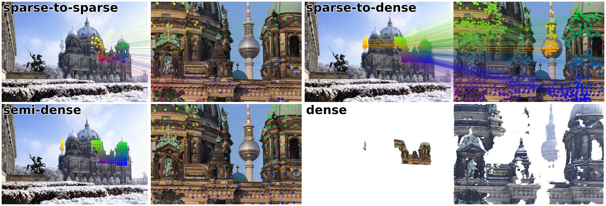
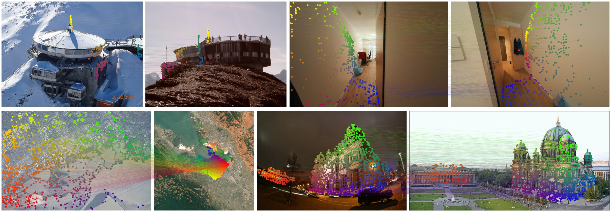
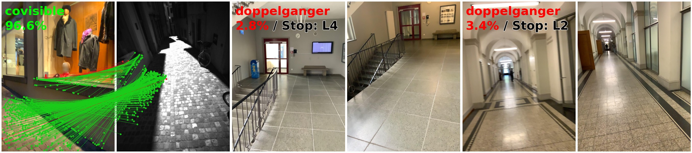
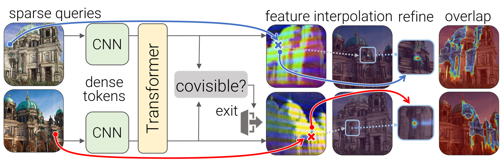

<p align="center">
  <h1 align="center"><ins>FlexGlue</ins> 🐙<br>Sparse-to-Dense Feature Matching and Visual Disambiguation</h1>
  <p align="center">
    <a href="https://www.linkedin.com/in/philipplindenberger/">Philipp Lindenberger</a>
    ·
    <a href="https://psarlin.com/">Paul-Edouard&nbsp;Sarlin</a>
    ·
    <a href="https://miksik.co.uk/">Ondrej&nbsp;Miksik</a>
    ·
    <a href="https://www.microsoft.com/en-us/research/people/mapoll/">Marc&nbsp;Pollefeys</a>
  </p>
  <h2 align="center">
    <a href="https://arxiv.org/abs/2610.32976" align="center">Paper</a> | 
    <a href="https://colab.research.google.com/github/cvg/FlexGlue/blob/main/demo.ipynb" align="center">Colab</a>
  </h2>

</p>
<p align="center">
    
    <br>
    <em>One model, four matching modes: FlexGlue provides matches tailored to each use-case.</em>
</p>
<p align="center">
    
    <br>
    <em>FlexGlue is robust under extreme viewpoint changes, low-texture environments, rotations, and lighting conditions.</em>
</p>
<p align="center">
    
    <br>
    <em>To match or not to match: A covisibility tells whether a pair is an unmatchable doppelganger and FlexGlue stops early on the latter.</em>
</p>

##

This repository hosts the inference code of FlexGlue, a feature matcher that works with any keypoints, with dense grids, or with no keypoints at all.
FlexGlue matches through dense features: we use a DINOv3-ConvNeXt to encode an image into a stride-8 feature map, a transformer refines both maps jointly, and each query point finds its correspondence in the other image by correlation.
On top, FlexGlue predicts whether the two images are covisible at all, which rejects look-alike pairs such as repeated facades.

<p align="center">
    
    <br>
    <em>A pair of images is encoded with a CNN backbone. Dense tokens are forwarded through a series of transformers gathering context within and between images.<br>The aggregated tokens are interpolated at sparse keypoints, and their coarse correspondence is estimated with a windowed soft-argmax.<br>A simple refinement head yields subpixel accuracy. Unmatchable image pairs are detected in every layer.</em>
</p>

## Installation and demo

Install this repo using pip:

```bash
git clone https://github.com/cvg/FlexGlue.git && cd FlexGlue
python -m pip install -e .
# or, without cloning:
python -m pip install git+https://github.com/cvg/FlexGlue.git
```

FlexGlue works with any keypoints. The examples below detect them with the extractors of [LightGlue](https://github.com/cvg/LightGlue):

```bash
# requires the latest LightGlue commit
python -m pip install git+https://github.com/cvg/LightGlue.git
```

We provide a [demo notebook](demo.ipynb) which shows all matching modes on an image pair and the rejection of a look-alike pair.

Here is a minimal script to match two images. Detection is optional:

```python
from lightglue import ALIKED
from flexglue import FlexGlue
from flexglue.utils import load_image, pack_matches, rbd

# load each image as a torch.Tensor on GPU with shape (3,H,W), normalized in [0,1]
image0 = load_image("assets/berlin1.jpg").cuda()
image1 = load_image("assets/berlin2.jpg").cuda()
inputs0, inputs1 = {"image": image0[None]}, {"image": image1[None]}

# optional: detect keypoints to be matched
detector = ALIKED(origin="corner", max_num_keypoints=2048).eval().cuda()
inputs0.update(detector.extract(image0))  # {keypoints, ...}
inputs1.update(detector.extract(image1))

# match: each keypoint (or sampled point) is paired with its predicted point in the other image
matcher = FlexGlue().eval().cuda()
matches01 = rbd(pack_matches(matcher.match(inputs0, inputs1)))
matches = matches01["matches"]  # indices with shape (K,2)
points0 = matches01["keypoints0"][matches[..., 0]]  # coordinates in image #0, shape (K,2)
points1 = matches01["keypoints1"][matches[..., 1]]  # coordinates in image #1, shape (K,2)
```

With keypoints in both images, `matcher.match(inputs0, inputs1, sparse=True)` instead matches the keypoints to each other, as LightGlue does: `matches` then indexes `inputs0["keypoints"]` and `inputs1["keypoints"]`.

We also provide a convenience method to match a pair of images directly:

```python
matches01 = rbd(pack_matches(matcher.match_pair(image0, image1, detector=detector)))
points0 = matches01["keypoints0"][matches01["matches"][..., 0]]
points1 = matches01["keypoints1"][matches01["matches"][..., 1]]
```

> [!IMPORTANT]
> FlexGlue assumes keypoints in corner coordinates (COLMAP convention): the center of the top-left pixel is at (0.5, 0.5). LightGlue assumes center coordinates (a 0.5 px offset), so pass `origin="corner"` to its detectors, e.g. `ALIKED(origin="corner")`.

## Matching modes

FlexGlue supports multiple matching modes, depending on whether keypoints are provided for each image and the selected mode (`sparse`):

| neither has keypoints | one has keypoints (`i`) | both have keypoints |
|---|---|---|
| sample correspondences | each keypoint of `i` gets a predicted point in `j` | matches in both directions concatenated (`sparse=False`) or mutual nearest neighbors (`sparse=True`) |

`matches` always indexes `keypoints0` and `keypoints1`. Without `sparse=True`, these are row-aligned lists of corresponding points (keypoints or sampled points paired with their predicted points), so row *k* of one matches row *k* of the other. With `sparse=True`, they are the input keypoints, matched to each other.

The snippet below shows **how to run each mode**, one after the other. The [demo notebook](demo.ipynb) shows the matches of each mode on an example pair.

```python
inputs0 = matcher.descriptor.describe(image0)  # {features, image_size}
inputs1 = matcher.descriptor.describe(image1)

# neither has keypoints: correspondences are sampled
pred = matcher.match(inputs0, inputs1)
# >>>
# keypoints0/1: (1, S, 2), sampled points
# matches0: (1, S), k for row k, or -1 if filtered

# one has keypoints: each keypoint of image #0 with its predicted point in image #1
inputs0.update(detector.extract(image0))  # {keypoints, ...}
pred = matcher.match(inputs0, inputs1)
# >>>
# keypoints0: (1, M, 2), detected keypoints <-- inputs0["keypoints"]
# keypoints1: (1, M, 2), predictions

# both have keypoints: concatenate bidirectional (default, recommended)
inputs1.update(detector.extract(image1))
pred = matcher.match(inputs0, inputs1)
# >>>
# keypoints0: (1, M+N, 2), [keypoints0, p2d1_i0]
# keypoints1: (1, M+N, 2), [p2d0_i1, keypoints1]

# both have keypoints: mutual nearest neighbors between the keypoints
pred = matcher.match(inputs0, inputs1, sparse=True)
# >>>
# keypoints0/1: (1, M, 2) / (1, N, 2)
# matches0: (1, M), index of the matched keypoint in image #1, or -1

# all modes return the same output format
matches01 = rbd(pack_matches(pred))
matches = matches01["matches"]  # indices with shape (K,2)
points0 = matches01["keypoints0"][matches[..., 0]]  # coordinates in image #0, shape (K,2)
points1 = matches01["keypoints1"][matches[..., 1]]  # coordinates in image #1, shape (K,2)
```

FlexGlue can also return dense correspondences directly:

```python
# dense grids only, without matching
pred = matcher.match_dense(inputs0, inputs1)
# dense_p2d0_i1: (B, h, w, 2), h x w = describe_resize / coarse_stride (64x64 by default)
```

For increased sub-pixel accuracy, we recommend to use the excellent [RoMa v2](https://github.com/Parskatt/RoMaV2) refiner, whose weights are downloaded automatically:

```python
# refined with the RoMa v2 refiners, at refine_resize resolution
matcher = FlexGlue(refine=True).eval().cuda()
pred = matcher.match_dense(inputs0, inputs1)
# dense_p2d0_i1: (B, h_r, w_r, 2), h_r x w_r = refine_resize (512x512 by default)
# or
pred = matcher.match(inputs0, inputs1)  # refined matches
```

**To improve matching accuracy and robustness**, the biggest lever is increased resolution (see Table 2 in the paper):

```python
# descriptor input at 640x640 instead of the default 512x512
matcher = FlexGlue(describe_resize=(640, 640)).eval().cuda()
```

<details>
<summary>[Detail of all outputs - click to expand]</summary>

Inputs per image (`inputs0`, `inputs1`), as returned by `DINOv3Descriptor.describe`, merged with a LightGlue detector:
- `features`: `(B, 256, h, w)` stride-8 feature map.
- `image_size`: `(B, 2)` image size `(w, h)` in pixels.
- `image`: `(B, 3, H, W)` the image, read by the refiner.
- `keypoints`: `(B, M, 2)` keypoints in pixels, optional.
- `descriptors`: `(B, M, 64)` descriptors of the keypoints, with `descriptor.describe(image, keypoints)`.

Outputs of `matcher(...)` and `matcher.match(...)`, for each direction `i -> j` whose image `i` has keypoints:
- `p2d{i}_i{j}`: `(B, M, 2)` predicted location of each keypoint of image `i` in image `j`, in pixels.
- `p2d{i}_n{j}`: `(B, M, 2)` the same, in normalized coordinates `[-1, 1]`.
- `confidence{i}`: `(B, M)` confidence that the keypoint has a correspondence. With the cycle check, the geometric mean of the forward confidence and the confidence of the prediction mapped back to `i`.
- `valid{i}`: `(B, M)` whether the keypoint passes the covisibility, border and cycle checks.
- `cycle_error{i}`: `(B, M)` cycle error in pixels, with `max_distance_px` and not `sparse=True`.
- `covisibility_score`: `(B,)` probability that the two images show the same place.
- `stop_layer`: the layer at which the matcher stopped.

Matches, as in LightGlue, also returned by `matcher(...)` and `matcher.match(...)` in every mode:
- `keypoints0`, `keypoints1`: the points that `matches0` and `matches1` index.
  - With `sparse=True`: the input keypoints, `(B, M, 2)` and `(B, N, 2)`.
  - Otherwise: row-aligned lists of corresponding points, `(B, K, 2)`. K is M+N with keypoints in both images, M with keypoints in one, and at most `max_num_samples` without keypoints.
- `matches0`, `matches1`: index of the match in the other image, or -1.
  - With `sparse=True`: `(B, M)` and `(B, N)`, from mutual nearest neighbors.
  - Otherwise: `(B, K)`. Both are the same tensor: row k matches row k, or -1 if filtered out.
- `matching_scores0`, `matching_scores1`: confidence of each match, 0 where unmatched. Same shapes as `matches0` and `matches1`.

Added by `pack_matches(pred)`, not returned by the matcher:
- `matches`: list of `(S, 2)` index pairs per batch element.
- `scores`: list of `(S,)` match confidences per batch element.

Dense matches, from `match_dense` and the sampled mode, per direction `i -> j`. The coarse grid has `h x w` = `describe_resize / coarse_stride` cells (64x64 by default), the refined grid `h_r x w_r` = `refine_resize` (512x512 by default):
- `dense_p2d{i}_i{j}`: `(B, h, w, 2)` correspondence of each cell of image `i` in image `j`, in pixels. At the refiner resolution `(B, h_r, w_r, 2)` with `refine=True`.
- `dense_p2d{i}_n{j}`: the same, in normalized coordinates.
- `dense_confidence{i}`: `(B, h, w)` confidence of each correspondence, zero where it fails a check.
- `dense_valid{i}`: `(B, h, w)` whether the correspondence passes the covisibility, filter, border and cycle checks.
- `dense_cov{i}_i{j}`: `(B, h_r, w_r, 2, 2)` covariance of the refined correspondences in pixels, with `refine=True`.

</details>

## Look-alike pairs and early stopping

`pred["covisibility_score"]` is the probability that the two images show the same place. With `min_covisibility > 0`, all matches of a pair below this score are rejected.
With `early_stop_decay`, FlexGlue also stops at an early layer once the pair is confidently rejected, which saves most of the compute on non-pairs (no batch support):

```python
pred = matcher.match(inputs0, inputs1, min_covisibility=0.8, early_stop_decay=0.2)
pred["is_covisible"]  # whether covisibility_score >= min_covisibility, only with min_covisibility > 0
pred["stop_layer"]  # the layer at which FlexGlue stopped
```

Note that all matches of a pair are invalidated if its `covisibility_score` is below `min_covisibility`, and FlexGlue returns empty matches in this case.

## Batch inference

FlexGlue matches a batch of image pairs in a single call. Images are passed as a batched tensor `(B, 3, H, W)` or as a list of `(3, H, W)` tensors, which may have different sizes:

```python
images0 = [load_image(path).cuda() for path in paths0]  # B images, any size
images1 = [load_image(path).cuda() for path in paths1]

# images only, or with a detector that returns a fixed number of keypoints
detector = ALIKED(origin="corner", max_num_keypoints=2048, detection_threshold=0.0).eval().cuda()
pred = matcher.match_pair(images0, images1, detector=detector)

# or describe first, e.g. to cache the descriptors
inputs0 = matcher.descriptor.describe(images0)  # {features, image_size, image}
inputs1 = matcher.descriptor.describe(images1)
pred = matcher.match(inputs0, inputs1)

pred = pack_matches(pred)  # lists of matches and scores, one entry per pair
for b in range(len(images0)):
    matches = pred["matches"][b]  # (K, 2)
    points0 = pred["keypoints0"][b][matches[..., 0]]  # pixels of images0[b]
    points1 = pred["keypoints1"][b][matches[..., 1]]  # pixels of images1[b]
```

Batching has a few requirements:
- Images of different sizes are squashed to the same `describe_resize` (the default `(512, 512)`). With an int `describe_resize` or `refine_resize`, all images must share the same aspect ratio.
- All images need the same number of keypoints, for example a detector with `max_num_keypoints` and `detection_threshold=0.0`.
- Early stopping only stops once all pairs of the batch are rejected.

## Advanced configuration

<details>
<summary>[Detail of all parameters - click to expand]</summary>

`DINOv3Descriptor`:
- ```resize```: Backbone input size: an int sets the long side (aspect kept, sides floored to multiples of 32), ```(h, w)``` squashes. Default: (512, 512).
- ```describe```: Also return descriptors at the given keypoints. Default: True.
- ```weights```: Path or URL of the weights. Default: the release weights.

`FlexGlue`:
- ```n_layers```: Number of transformer layers, fewer is faster but less accurate. Default: 9 (all).
- ```filter_threshold```: Minimum match confidence. Default: 0.1.
- ```max_distance_px```: Maximum cycle error, or mutual nearest-neighbor distance in sparse mode, in pixels of the resized image. None disables it. Default: 3.0.
- ```min_covisibility```: Reject all matches of pairs with a lower ```covisibility_score```, e.g. 0.8 for noisy image sets. Default: 0.0 (off).
- ```early_stop_decay```: Stop after layer ```k``` if ```covisibility_score < min_covisibility * (1 - early_stop_decay) ** (9 - k)```, lower stops earlier. Default: None (off).
- ```remove_border_px```: Drop matches this close to the border, in pixels of the resized image. Default: 0.0.
- ```mp```: Transformer mixed precision: ```"float16"```, ```"bfloat16"``` or ```None``` (float32). Default: ```"float16"```.
- ```describe_resize```: Input size of the built-in descriptor, as ```resize``` above. Default: (512, 512).
- ```gemm_nn```: Sparse mode: mutual nearest neighbors in one matrix multiplication, faster for many keypoints. Default: True.
- ```exact_nn```: With ```gemm_nn```, compute the squared distances from coordinate differences instead of one matrix multiplication: slower but exact, also where float32 matrix multiplications run in TF32. Default: False.
- ```query_chunk_size```: Points per correspondence-head call, bounds memory without changing results. None processes all points at once. Default: 4096.
- ```weights```: Path or URL of the weights. Default: the release weights.
- ```coarse_stride```: Grid pitch of ```match_dense``` and the sampled mode, in pixels of the resized image (4 doubles the resolution). Default: 8.
- ```max_num_samples```: Maximum number of sampled matches without keypoints. Default: 5000.
- ```kde_balance```: Spread the sampled matches over the image as RoMa v2, instead of drawing by confidence. Default: True.
- ```refine```: Refine with RoMa v2 refiners (needs ```image``` in the inputs). Default: False.
- ```refine_resize```: Input size of the refiners, as ```resize``` above. Default: (512, 512).
- ```refine_scales```: Refiner strides, coarse to fine, fixed at construction. Default: (2, 1).

</details>

The default values give a good trade-off between speed and accuracy. For increased efficiency, use fewer layers to linearly reduce run time:
```python
matcher = FlexGlue(n_layers=6)
```
`n_layers=0` is also supported and falls back to matching the descriptors, without any transformer layer.

To obtain fewer but more reliable matches, raise the confidence threshold and bound the cycle error in pixels of the resized image. These parameters can be specified at initialization or overwritten per-call:
```python
matcher = FlexGlue(filter_threshold=0.2, max_distance_px=2.0)
pred = matcher.match(inputs0, inputs1, filter_threshold=0.2, max_distance_px=2.0)
```

For keypoint-less matching, you can specify a maximum number of samples (correspondences are still filtered):
```python
pred = matcher.match_pair(image0, image1, max_num_samples=1024)
```

FlexGlue can be compiled with `torch.compile`, as LightGlue:
```python
matcher = FlexGlue().eval().cuda().compile(mode="reduce-overhead")
```
The transformer layers and the correspondence heads are compiled into CUDA graphs. Keypoints are padded to the next of `static_lengths` (512, 1024, 2048, 4096 by default), larger inputs fall back to eager mode. The first calls of each new input size are slow while compiling.

## torch.hub

FlexGlue can also be loaded with `torch.hub`, without installing this repository. Arguments are passed to `FlexGlue`:
```python
import torch

matcher = torch.hub.load("cvg/FlexGlue", "flexglue", trust_repo=True).eval().cuda()
matcher = torch.hub.load("cvg/FlexGlue", "flexglue", trust_repo=True, refine=True)  # with arguments
```

## ONNX export

FlexGlue can be exported to [ONNX](https://onnx.ai/) and run with [ONNX Runtime](https://onnxruntime.ai/), without PyTorch. The export is split into two models:
- [`flexglue_descriptor.onnx`](https://github.com/cvg/FlexGlue/releases/download/v0.1/flexglue_descriptor.onnx): `image (1, 3, 512, 512)` in [0, 1], squashed to 512x512 with a bilinear resize -> dense `features (1, 256, 64, 64)`. It runs once per image.
- [`flexglue_matcher.onnx`](https://github.com/cvg/FlexGlue/releases/download/v0.1/flexglue_matcher.onnx) (or [`flexglue_matcher_fp16.onnx`](https://github.com/cvg/FlexGlue/releases/download/v0.1/flexglue_matcher_fp16.onnx) with float16 transformer layers, for CUDA): the sparse mode, which matches the keypoints of two images given their dense features. It returns `matches0`, `mscores0` and the `covisibility_score` of the pair. `filter_threshold`, `max_distance_px` and `min_covisibility` are inputs of the model and can be changed at runtime. Unlike in PyTorch, `max_distance_px = 0` rejects all matches: use `inf` to disable the check. Both images need at least one keypoint.

The models are available in the [release](https://github.com/cvg/FlexGlue/releases/tag/v0.1) and are used by [COLMAP](https://github.com/colmap/colmap). [onnx/match_pair.py](onnx/match_pair.py) shows how to match two images with them, using only numpy, OpenCV and ONNX Runtime:
```bash
python -m pip install onnxruntime-gpu opencv-python  # or onnxruntime for CPU only
python onnx/match_pair.py assets/berlin1.jpg assets/berlin2.jpg --output matches.png
```

To export the models yourself (requires `onnx` and `onnxscript`) and check them against PyTorch (also requires `onnxruntime`):
```bash
python onnx/export.py                        # descriptor + float32 matcher
python onnx/export.py --fp16 --matcher_only  # float16 matcher
python onnx/check.py --descriptor onnx/models/flexglue_descriptor.onnx \
    --matcher onnx/models/flexglue_matcher.onnx
```
`onnx/check.py` can check any exported model, e.g. those of the release, against a PyTorch checkpoint (`--weights`).
The exported matcher has no refinement and uses the fused attention and GELU operators of ONNX Runtime (`--no_fused_attention` exports standard ONNX operators instead).
By default, it runs all transformer layers. With `--early_stop_layers 2,4,6,8`, it stops early on pairs that are confidently not covisible, as `early_stop_decay` does in PyTorch:
- After each listed layer `k`, it rejects the pair without running the remaining layers if its covisibility score is below `min_covisibility * (1 - early_stop_decay) ** (9 - k)`.
- The checks are ONNX `If` nodes, and `early_stop_decay` is an additional input of the model. 1 never stops early.
- On the exhaustive pairs of ETH3D with `min_covisibility=0.8` and `early_stop_decay=0.5`, this skips most of the computation of 42% of the pairs and practically never rejects a pair that would pass `min_covisibility` (0.08% of them).

The matchers of the v0.1 release were exported at different stages: [`flexglue_matcher_early_stop.onnx`](https://github.com/cvg/FlexGlue/releases/download/v0.1/flexglue_matcher_early_stop.onnx) and [`flexglue_matcher_early_stop_fp16.onnx`](https://github.com/cvg/FlexGlue/releases/download/v0.1/flexglue_matcher_early_stop_fp16.onnx), used by COLMAP, with the fused GELU operator and `--early_stop_layers 2,4,6,8`; `flexglue_matcher{,_fp16}.onnx` earlier, without the fused GELU operator, which only changes the outputs by float rounding. Exporting the early-stopping matchers again with `export.py` gives the same graphs, but not byte-identical files, since the graphs also store the source location of each node.

## Checklist

- [x] Publish the inference code
- [ ] Integration into [COLMAP](https://github.com/colmap/colmap)
- [ ] Integration into [hloc](https://github.com/cvg/Hierarchical-Localization)
- [ ] Release the training and evaluation code in [glue-factory](https://github.com/cvg/glue-factory)

## License
The code provided in this repository is released under the [MIT license](./LICENSE). The model weights (`flexglue.pth`) contain the [DINOv3](https://github.com/facebookresearch/dinov3) ConvNeXt-B backbone (`extractor.backbone.*`), which is distributed under the [DINOv3 License](./DINOv3_LICENSE.md) and restricts its use. All other weights, the matcher and the descriptor heads, are released under the MIT license. The refiners in [refiner.py](./flexglue/refiner.py) and their weights come from [RoMa v2](https://github.com/Parskatt/RoMaV2) and follow its MIT license. The keypoint detectors are not part of this repository, see [LightGlue](https://github.com/cvg/LightGlue#license) for their licenses.

## BibTeX citation
If you use any ideas from the paper or code from this repo, please consider citing:

```txt
@article{lindenberger2026flexglue,
  author    = {Philipp Lindenberger and
               Paul-Edouard Sarlin and
               Ondrej Miksik and
               Marc Pollefeys},
  title     = {{FlexGlue: Sparse-to-Dense Feature Matching and Visual Disambiguation}},
  journal   = {arXiv preprint arXiv:2610.32976},
  year      = {2026}
}
```
